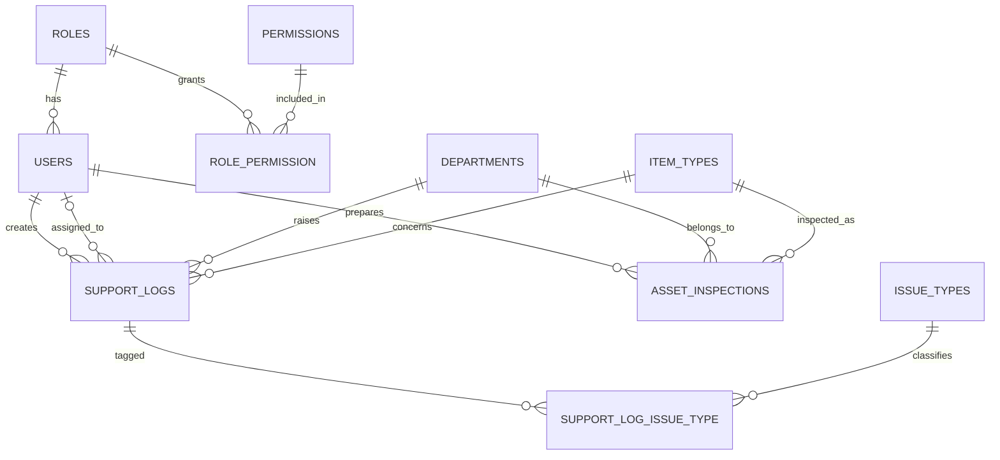

# CEF365: Backend

## log-report and  asset inspection form
Laravel JSON APIs for the 
- IT Support Log System (only for internal ICT department usage).
- Asset/Item Inspection form (form for ICT department and then pdf for admin department)
- It uses Laravel Sanctum cookie (SPA) authentication
- permission-based role access control (RBAC).

## Database overview

Three areas: access control (roles and permissions), IT support logs, and asset inspections.


## -----------------------------------

## -----------------------------------

--- Current `Item_TYPES`

| Category | ~Tickets | Category | ~Tickets |
|---|---|---|---|
| Laptop | ~385 | AV & Cabling | ~11 |
| Email | ~65 | Internet (→Network) | ~11 |
| Desktop | ~70 | Procurement | ~14 |
| Display & Projection | ~38 | Scanner | ~10 |
| Meeting | ~50 | CCTV | ~9 |
| Network | ~23 | Support | ~9 |
| Data & Backup | ~31 | Servers | ~8 |
| Printer | ~34 | Accessories / Components / Mobile / Accounts / Applications | ~25 |

--- Current `STATUS`
closed
in_progress
indoor_repairing
outdoor_repairing
resolved

--- Current `Issue Type`
Hardware
Software
Hardware & Software


## ============================= Current Roles and permission assigning
```
 Illuminate\Support\Collection {#7731
    all: [
      [
        "super_admin",
        [
          "manage_dashboard",
          "dashboard_support_logs",
          "dashboard_asset_inspections",
          "user_performance",
          "manage_support_logs",
          "manage_asset_inspections",
          "create_asset_inspections",
          "manage_departments",
          "manage_item_types",
          "manage_issue_types",
          "manage_users",
          "manage_role_permissions",
        ],
      ],
      [
        "ict_manager",
        [
          "manage_dashboard",
          "dashboard_support_logs",
          "dashboard_asset_inspections",
          "user_performance",
          "manage_support_logs",
          "manage_asset_inspections",
          "create_asset_inspections",
          "manage_item_types",
          "manage_issue_types",
        ],
      ],
      [
        "ict_staff",
        [
          "manage_dashboard",
          "dashboard_support_logs",
          "dashboard_asset_inspections",
          "manage_support_logs",
          "manage_asset_inspections",
          "create_asset_inspections",
        ],
      ],
      [
        "admin_approver",
        [
          "manage_dashboard",
          "dashboard_asset_inspections",
          "manage_asset_inspections",
        ],
      ],
    ],
  }
```
## ======================================== Dashboard

What each returns
Endpoint	Who	Data
/dashboard/support-logs	super_admin, ict_manager (all logs), ict_staff (own)	total, by_status, last_7_days
/dashboard/asset-inspections	everyone with the permission	total, by_approval_status, needs_my_signature, returned_to_me
/dashboard/user-performance	super_admin, ict_manager	unchanged
 
## ==== Dashboard permissions

// for dashboard tab in frontend
'manage_dashboard',

'dashboard_support_logs',
'dashboard_asset_inspections',
'user_performance',
'dashboard_department_view',
'dashboard_all_view',

## ==== Dashboard

The design

Instead of hard-coding “role X sees dashboard Y”, every dashboard endpoint takes a scope query parameter (?scope=mine, department or all):

Scope	What it counts	Permission needed
mine	Records you are involved in	none (everyone)
department	Records involving anyone in your department	dashboard_department_view
all	Everything	dashboard_all_view

Two new permissions give you these tabs per role:

Role	Tabs	Content
super_admin	Mine, Department, All	support logs and inspections
ict_manager	Mine, Department, All	support logs and inspections
ict_staff	Mine	support logs and inspections (own only)
admin_approver	Mine, Department	inspections only (no support-log permission)

====

