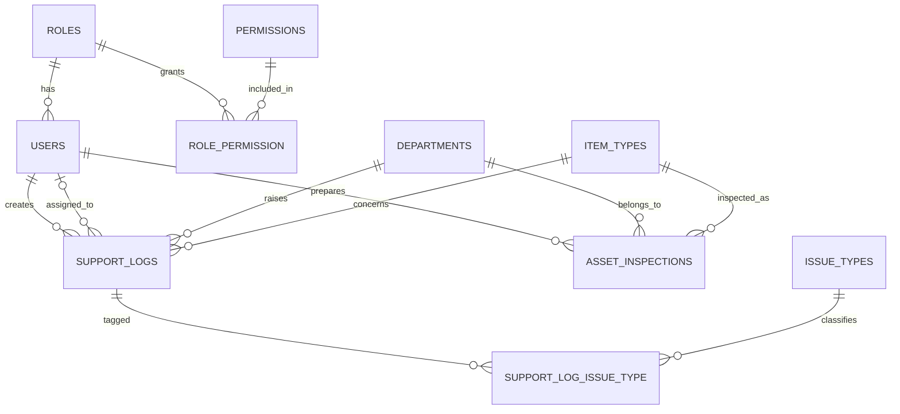

# CEF365: Backend

## log-report and  asset inspection form
Laravel JSON APIs for the 
- IT Support Log System (only for internal ICT department usage).
- Asset/Item Inspection form (form for ICT department and then pdf for admin department)
- It uses Laravel Sanctum cookie (SPA) authentication
- permission-based role access control (RBAC).

## Database overview

Three areas: access control (roles and permissions), IT support logs, and asset inspections.

## -----------------------------------

## -----------------------------------

--- Current `Item_TYPES`

| Category | ~Tickets | Category | ~Tickets |
|---|---|---|---|
| Laptop | ~385 | AV & Cabling | ~11 |
| Email | ~65 | Internet (→Network) | ~11 |
| Desktop | ~70 | Procurement | ~14 |
| Display & Projection | ~38 | Scanner | ~10 |
| Meeting | ~50 | CCTV | ~9 |
| Network | ~23 | Support | ~9 |
| Data & Backup | ~31 | Servers | ~8 |
| Printer | ~34 | Accessories / Components / Mobile / Accounts / Applications | ~25 |

--- Current `STATUS`
closed
in_progress
indoor_repairing
outdoor_repairing
resolved

--- Current `Issue Type`
Hardware
Software
Hardware & Software